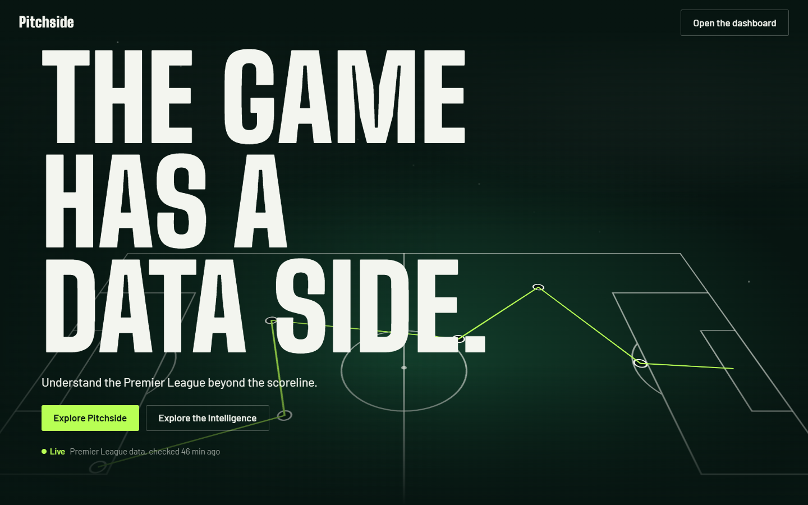
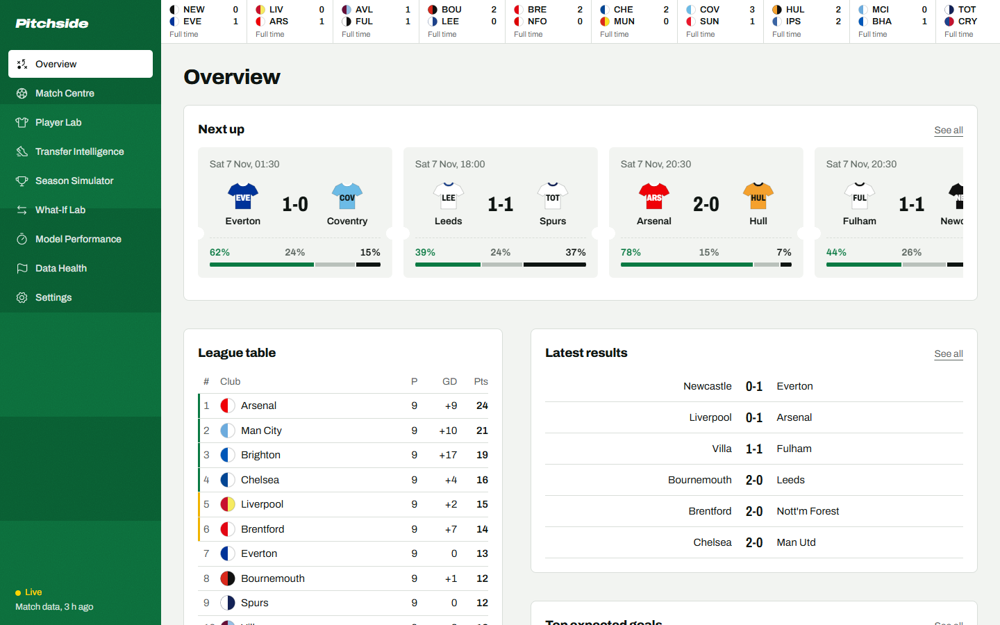
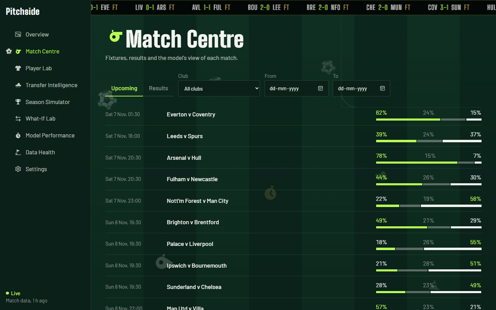
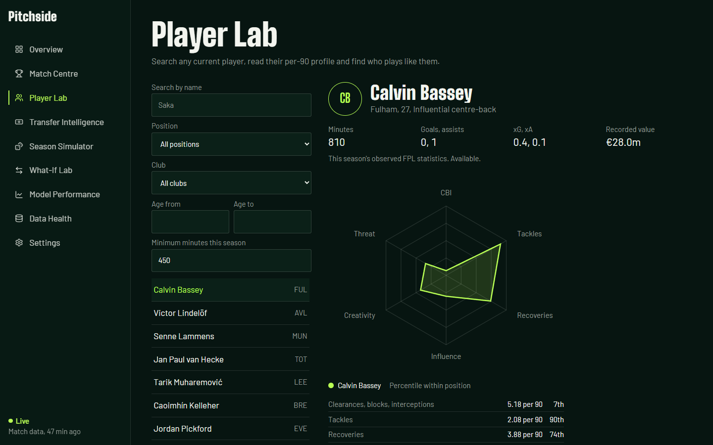
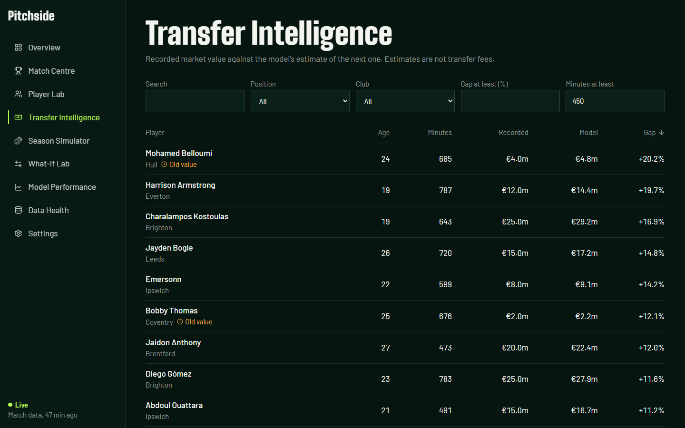
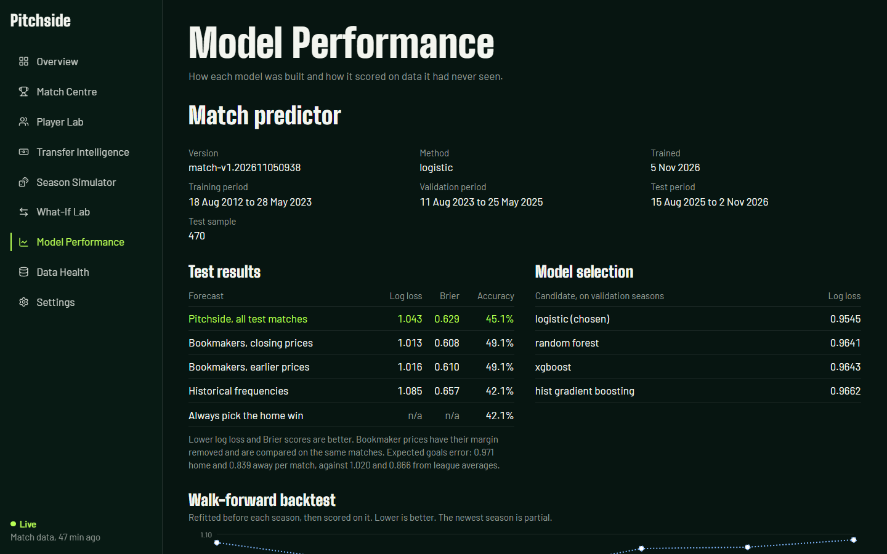

# Pitchside

A Premier League intelligence platform with live data, three machine learning models and two simulators.



## Features

- **The page is a pitch**: scroll from the centre circle to the goal, with a ball you can kick, teams that hold their shape around it, and a score strip of real fixtures.
- **Match Centre**: win, draw and loss chances, expected goals, scoreline grids and team form.
- **Player Lab**: per-90 profiles, role labels, similar-player search and radar comparison.
- **Transfer Intelligence**: recorded value against a model estimate with a measured range.
- **Season Simulator** (API only, off the site for now): Monte Carlo over the remaining fixtures with full league tie-breaks.
- **Model Performance** and **Data Health**: measured results, limits and live source status.

Pitchside provides statistical analysis and predictive estimates for informational purposes only. It is not betting advice, and predictions are inherently uncertain.

## Architecture

```text
 FPL API ───────────┐
 football-data.co.uk ┤                ┌─ features ── models ── predictions ─┐
 Transfermarkt dump ─┼─ snapshots ── entity ── DuckDB                       ├─ FastAPI ── React
 football-data.org ──┤  (last good    resolution  │                         │  /api/v1    site
 Understat ──────────┘   copy kept)               └─ simulator, what-if ────┘
                              ▲
                     APScheduler refresh jobs
```

Layers stay apart: `data/` fetches and normalises, `features/` builds inputs, `models/` trains and infers, `services/` holds business logic, and `api/` only routes. See [docs/methodology.md](docs/methodology.md) and [docs/data-sources.md](docs/data-sources.md).

## Technology

| Area | Stack |
|---|---|
| Backend | Python 3.14, FastAPI, Pydantic, DuckDB, pandas, NumPy, SciPy, scikit-learn, XGBoost, APScheduler, HTTPX, RapidFuzz, structlog |
| Frontend | React 19, Vite, TypeScript, Tailwind CSS, Archivo variable, GSAP with ScrollTrigger, Lenis, Framer Motion, Recharts, TanStack Query, Zustand, Phosphor Icons |
| Testing | pytest, respx, Vitest, Testing Library, Playwright |

SQLAlchemy is not used: all SQL sits in services and repositories, so a move to PostgreSQL stays contained. React Bits components are not used either, because the hand-built motion needed nothing from them.

## Repository

```text
backend/app/      api, core, data, database, features, models, services, simulation, tests
backend/scripts/  ingest, train, bootstrap, entities
frontend/src/     app, pages, features, components, animations, services, stores, types
frontend/e2e/     Playwright journeys
scripts/          Windows setup and start
docs/             data sources, methodology, screenshots
```

## Prerequisites

Python 3.12 or newer, and Node 22 or newer. Docker is optional. The first bootstrap downloads about 70 MB and takes about 10 minutes.

## Quick start on Windows

Keep the venv and data out of OneDrive, because sync clients lock DuckDB files. These scripts do that. `npm install` still writes `frontend
ode_modules` inside the project.

```powershell
powershell -ExecutionPolicy Bypass -File scripts\setup.ps1
```

```powershell
powershell -ExecutionPolicy Bypass -File scripts\start.ps1
```

Open http://127.0.0.1:8000. The site and API share one port, and data refreshes on schedule while it runs.

## Manual install

```bash
pip install -r backend/requirements-dev.txt
```

```bash
npm --prefix frontend install
```

```bash
cp .env.example .env
```

## Environment variables

| Name | Default | Purpose |
|---|---|---|
| `FOOTBALL_DATA_API_KEY` | empty | Optional. Adds official standings with point deductions |
| `PITCHSIDE_DATA_DIR` | `backend/data` | DuckDB file, snapshots and model artifacts |
| `ADMIN_TOKEN` | empty | Required for `/api/v1/admin/*`. Empty disables those routes |
| `SCHEDULER_ENABLED` | `true` | Runs refresh jobs inside the API |
| `CORS_ORIGINS` | `http://localhost:5173` | Allowed browser origins |
| `LOG_LEVEL` | `INFO` | Log detail |
| `REFRESH_*_HOURS` | see `.env.example` | Refresh interval per source |
| `PREDICTIONS_REFRESH_HOURS` | `6` | Predictions, live scoring and simulation |
| `MODEL_RETRAIN_HOURS` | `168` | Match model retraining |

## Running

Backend on port 8000:

```bash
cd backend && uvicorn app.main:app --reload --port 8000
```

Frontend dev server on port 5173, proxying `/api` to the backend:

```bash
npm --prefix frontend run dev
```

Production build, which the backend then serves itself:

```bash
npm --prefix frontend run build
```

Docker, which has not been run because Docker is not installed on the build machine:

```bash
docker compose up --build
```

Inside the container, run `python -m scripts.bootstrap` once with the API stopped.

## Public site

GitHub Pages cannot run the Python backend, so `.github/workflows/refresh-site.yml` does the work every 15 minutes, and again on any push that changes the app. It restores the database from the Actions cache, fetches scores and injuries, stores new predictions, exports the API to JSON, builds the frontend and pushes it to `gh-pages`. Slower sources and the match model refresh weekly. An empty cache triggers a full rebuild.

Everything it exports is labelled cached, never live. To use football-data.org in that job, add `FOOTBALL_DATA_API_KEY` as a repository secret. Without it, scores and the table come from FPL.

## Database

`open_connection` applies ordered files in `backend/app/database/migrations/` once each, so setup needs no extra command. DuckDB allows one writer process, so stop the API before running a command below.

## Data ingestion

Everything, from nothing, including training:

```bash
cd backend && python -m scripts.bootstrap
```

All sources, or one:

```bash
cd backend && python -m scripts.ingest
```

```bash
cd backend && python -m scripts.ingest fpl
```

Source ids: `football_data_uk`, `fpl`, `fpl_history`, `football_data_org`, `transfermarkt`, `understat`.

Review entity matches:

```bash
cd backend && python -m scripts.entities list
```

## Model training and evaluation

Training evaluates in the same run and prints the metrics. It stores them with the model version.

```bash
cd backend && python -m scripts.train
```

```bash
cd backend && python -m scripts.train match
```

Also available as `similarity` and `transfer`. Stored predictions are scored against real results automatically after kickoff, shown as `live` metrics once at least five exist.

## API

Interactive docs are at `/api/docs`. Everything sits under `/api/v1`.

| Area | Routes |
|---|---|
| Fixtures | `GET /fixtures`, `/fixtures/upcoming`, `/fixtures/{id}`, `/fixtures/{id}/prediction` |
| Matches | `GET /matches/results`, `/matches/teams/{id}/form`, `/teams`, `/standings` |
| Players | `GET /players`, `/players/compare`, `/players/{id}`, `/players/{id}/statistics`, `/players/{id}/similar` |
| Transfers | `GET /transfers/values`, `/transfers/undervalued`, `/transfers/{id}/valuation` |
| Simulation | `POST /simulation/season`, `GET /simulation/latest`, `/simulation/history`, `/simulation/{id}` |
| What-if | `POST /what-if/player-replacement`, `GET /what-if/{id}`, `/what-if/teams/{id}/squad` |
| Models | `GET /models`, `/models/metrics`, `/models/metrics/match`, `POST /admin/models/retrain` |
| Data | `GET /data/sources`, `/data/health`, `/data/last-updated` |
| System | `GET /health`, `/ready` |

Errors share one shape: `{"error": {"code": "...", "message": "..."}}`.

## Data sources and refresh

See [docs/data-sources.md](docs/data-sources.md) for verification results, limits and schedules.

## ML methodology and leakage prevention

See [docs/methodology.md](docs/methodology.md). In short, features are written from state before each match, splits are by date and asserted, and tests prove that changing a result never changes an earlier row.

## Model limitations

- The match model has no tactics, confirmed line-ups or manager changes.
- Team xG exists only for 2026-27, so it is not a feature yet.
- It beats naive baselines but not bookmaker prices.
- Simulations hold team strength fixed, so the real spread is probably wider.
- Valuations come from a third-party dump that lags the live site.
- Player profiles only use what FPL publishes.

## Testing

```bash
cd backend && python -m pytest
```

```bash
cd backend && ruff check app scripts && mypy app scripts
```

```bash
npm --prefix frontend test
```

```bash
npm --prefix frontend run typecheck
```

End-to-end, with the site running on port 8000 and Microsoft Edge installed:

```bash
npm --prefix frontend run e2e
```

## Screenshots

| | |
|---|---|
|  |  |
|  |  |
|  |

## Known issues

- Understat is down, so its loader has only been tested against the maintenance page. The `soccerdata` path has not run live.
- Without a football-data.org key, the league table comes from results and ignores points deductions.
- The transfermarkt-datasets maintainers paused updates in July 2026 with no return date, so that source shows as Stale and valuations stop at June 2026. That is correct, and it recovers by itself if they resume.
- 37 current squad players have no Transfermarkt link, mostly academy players. They are on the review list if they have played.
- DuckDB allows one writer, so ingest commands fail while the API runs.
- Lighthouse: homepage performance 99 on desktop. On throttled mobile the homepage scores 79 and the dashboard 83, under the 85 aim. Accessibility is 100 and layout shift is 0 on both.
- The Docker setup has not been built or run.

## Future improvements

- Use xG as a model feature once a full season exists.
- Add team strength uncertainty to the simulator.
- Add confirmed line-ups close to kickoff.
- Bring in a fuller event data source for shots and passing.
- Move to PostgreSQL if several writers are needed.
